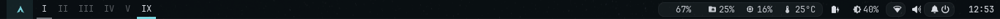
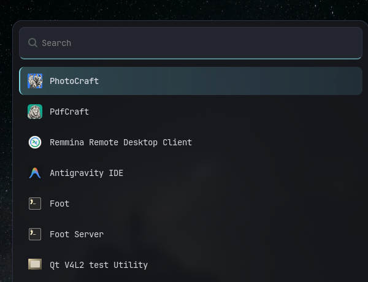
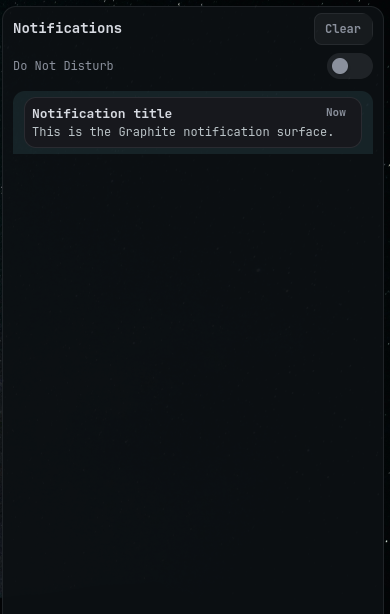

# pdev-desktop

A Graphite/teal desktop for **Arch Linux + Hyprland**: a wallpaper-derived palette, grouped Waybar clusters, a custom wofi launcher, themed SwayNC, kitty, Qt and a static-wallpaper Hyprlock.

<p align="center">
  
</p>

| wofi | SwayNC |
|---|---|
|  |  |

## Features

- **One palette everywhere** — kitty, Ghostty, Waybar, wofi, SwayNC, Hyprlock, Qt (qt6ct) and starship all use the same tokens.
- **Waybar pill clusters** — `system` (memory/disk/CPU/temp), `net` (Bluetooth/Wi-Fi) and `actions` (DND/power), plus 1–10 clickable Roman-numeral workspaces with occupancy underlines.
- **Silent volume scroll** — scrolling changes volume without a popup; hovering shows `Volume 50%` with a 24-cell bar.
- **Wofi** — 560×420, 16 px corners, cyan→blue selection, real rounded corners, blurred/dimmed backdrop.
- **SwayNC** — 380 px control centre, Graphite cards, cyan progress bar, DND switch.
- **Hyprlock** — static wallpaper background (no screencopy), blurred, JetBrains Mono clock, password dots, error/caps-lock colours.
- **Hyprland** — 3/6 gaps, 10 px rounding, cyan→blue borders, soft shadows, inactive dim, wofi-only blur (windows stay sharp for the iGPU).
- **Kitty** — JetBrains Mono Nerd Font Mono, Graphite ANSI palette, 6 px padding, beam cursor, thin cyan scrollbar, select-to-copy.

## Palette

| Role | Hex |
|---|---|
| Background | `#0b1013` |
| Surface | `#17181d` |
| Elevated | `#23262e` |
| Foreground | `#d7dae1` |
| Muted | `#8a909c` |
| Accent (cyan) | `#7ad6e0` |
| Secondary (blue) | `#7aa2f7` |
| Warning | `#f0cf8e` |
| Critical | `#ff7b86` |

## Requirements

- Arch Linux (the package step uses `pacman`)
- Hyprland **0.56+** (Lua config), Waybar **0.15+**
- A 1366×768 panel is assumed for the lock layout; everything else scales
- `yay` for the AUR package (`clipse`) — optional

The curated package list is in [`dotfiles/packages/desktop.txt`](dotfiles/packages/desktop.txt). `dotfiles/packages/optional/` contains the author's full explicit package lists for reference.

## Install

```bash
git clone https://github.com/pdev-labs/pdev-desktop.git
cd pdev-desktop
```

Review and preview first:

```bash
less install.sh
bash install.sh --dry-run
```

Full install (packages + AUR + theme + services):

```bash
bash install.sh --packages --aur --yes
```

`--packages` calls `sudo pacman -S --needed`; `--aur` calls `yay` for `clipse`. The installer also copies the configs, installs the GTK/Qt theme, enables SwayNC, reloads Hyprland/Waybar and validates the result.

**Log out and back in** afterwards so `hypridle`, `hyprpolkitagent`, `QT_QPA_PLATFORMTHEME` and the new Hyprland autostarts run in a fresh environment.

### Configs only

If the packages are already installed:

```bash
bash install.sh
```

It backs up every file it replaces to `~/backups/pre-apply-<timestamp>/`.

### Install without packages

```bash
bash install.sh --dry-run     # see exactly what changes
bash install.sh --yes         # apply only configs + services
```

### Restore from an archive

```bash
bash install.sh --from-backup ~/backups/dotfiles-2026-10-31-124134.tar.zst
```

Paths are rewritten from `/home/pdev` to your `$HOME` automatically.

## Keybindings

| Keys | Action |
|---|---|
| `SUPER + Return` | kitty |
| `SUPER + Q` | close window |
| `SUPER + M` | power menu (wofi) |
| `SUPER + F` | Nautilus |
| `SUPER + Space` | wofi launcher |
| `SUPER + B` | Firefox |
| `SUPER + V` | toggle floating |
| `SUPER + P` | pseudo-tile |
| `SUPER + D` | toggle split |
| `SUPER + H/J/K/L` | focus left/down/up/right |
| `SUPER + Shift + H/J/K/L` | move window |
| `SUPER + Ctrl + H/J/K/L` | resize window |
| `SUPER + 1…0` | workspace 1–10 |
| `SUPER + Shift + 1…0` | move window to workspace |
| `SUPER + S` | special workspace |
| `SUPER + Escape` | lock (Hyprlock) |
| `SUPER + Shift + Return` | fullscreen |
| `ALT + Tab` | cycle windows |
| `SUPER + C` | clipse clipboard picker |
| `SUPER + F6/F7` | brightness down/up |
| Media keys | playerctl / volume |

Workspaces **6–10 are dynamic**: they appear in the bar only when active or occupied. Create them with `SUPER + 6…0`.

## Structure

```
install.sh                 installer / restore script
backup.sh                  snapshot this machine to ./dotfiles + ~/backups
apply-gtk-theme.sh         GTK3/GTK4 + icon theme setup
dotfiles/
  home/                    files copied to $HOME
    .config/hypr/          Hyprland, Hyprlock, Hypridle, scripts
    .config/waybar/        config.jsonc, style.css, ws/audio scripts
    .config/wofi/          launcher config + theme
    .config/kitty/         terminal + Graphite palette
    .config/ghostty/       Ghostty palette
    .config/swaync/        notification daemon theme
    .config/qt6ct/         Qt palette
    .config/{fastfetch,bat,htop,lsd,nvim}/
    .bashrc .bash_profile .profile .tmux.conf
    .icons/Adwaita-Tiny/   cursor theme
    wallpaper/             wallpaper used by swaybg and Hyprlock
  packages/
    desktop.txt            curated pacman packages
    aur-desktop.txt        curated AUR packages
    optional/              author's full explicit lists (reference)
```

## Customisation

Start with the palette tokens:

- `dotfiles/home/.config/waybar/style.css` — `@define-color`
- `dotfiles/home/.config/wofi/style.css` — `@define-color`
- `dotfiles/home/.config/swaync/style.css` — `:root` variables
- `dotfiles/home/.config/kitty/kitty.conf` — `foreground`, `background`, `color0…15`
- `dotfiles/home/.config/hypr/hyprland.lua` — border colours, gaps, rounding, shadows

Waybar names a group container after the group itself, so the CSS IDs are **`#system`**, **`#net`** and **`#actions`** — not `#group-system`.

Hyprlock uses a **static** image (`path = ~/wallpaper/...`) instead of `path = screenshot`, so a disappearing virtual output cannot take the lock surface down with it.

## Backup

```bash
bash backup.sh
```

Creates `~/backups/dotfiles-<timestamp>.tar.zst` (mode `600`) plus a SHA-256 file, refreshes `./dotfiles`, and keeps the last 10 archives.

Include selected `/etc` files:

```bash
sudo bash backup.sh --system
```

`backup.sh` deliberately excludes browser profiles, `clipse` clipboard history, caches, and credentials.

## Troubleshooting

**Waybar group pills are missing**  
Check that you are styling `#system`, `#net`, `#actions`. A group named `group/system` is exposed as `#system` by Waybar.

**Hyprlock shows a black screen or exits**  
Check `~/.cache/hyprlock.log`. The config uses a static wallpaper background and logs stderr from every entry point.

**GTK apps still look stock**  
Install once and re-run:

```bash
sudo pacman -S adw-gtk-theme papirus-icon-theme
bash apply-gtk-theme.sh
```

Then reopen Nautilus/pavucontrol/blueman.

**Electron apps do not start**  
XWayland is disabled in `hyprland.lua`. Launch with `--ozone-platform=wayland`, or enable XWayland if you need it.

**No lock/suspend on idle**  
`hypridle` must be installed and started (the installer does both on the next login). Check `pgrep hypridle`.

**Hyprland config errors**  
```bash
hyprctl configerrors
hyprctl reload
```

**Waybar debug**
```bash
pkill -x waybar
waybar -l debug
```

## Security

No credentials are published. `~/.config/omniroute/env`, browser profiles, clipboard history and personal systemd units are excluded. If you fork this, keep it that way.

## Credits

- Wallpaper: **Jonatan Pie** on Unsplash (`h8nxGssjQXs`)
- Font: **JetBrains Mono Nerd Font**
- [Hyprland](https://hypr.land), [Waybar](https://github.com/Alexays/Waybar), [wofi](https://hg.sr.ht/~scoopta/wofi), [SwayNC](https://github.com/ErikReider/SwayNotificationCenter), [kitty](https://sw.kovidgoyal.net/kitty/)
- GTK theme: `adw-gtk-theme`; icons: Papirus

## License

MIT — see [LICENSE](LICENSE).
